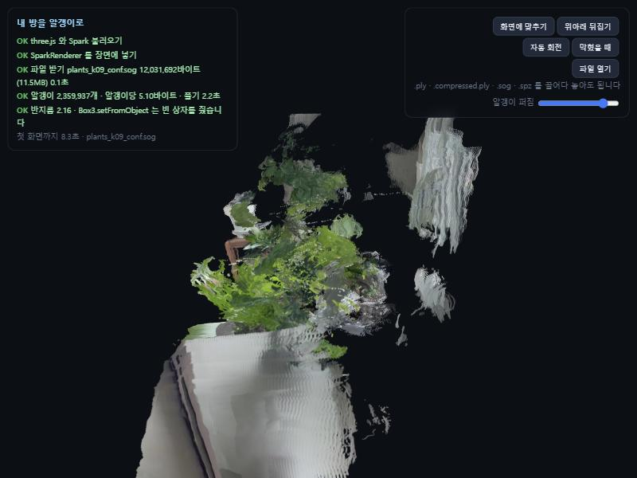

# 폰으로 찍은 방을 3D 로

방을 십오 초쯤 걸어 다니며 찍은 영상 하나에서 3차원 장면을 만들고 웹에 올린 것입니다.

**보기** https://crystalmoon74.github.io/room-3d-demo/ (창가 화분 실습)
· 장면 파일 직접 받기 https://crystalmoon74.github.io/room-3d-demo/plants_k09_conf.sog
· 원본 데모 https://suncreation.github.io/room-3d-demo/



## 과제 제출: 공개 가능한 공간의 3D 뷰어 (2026-11-13)

| 제출 | 주소 |
|---|---|
| Pages | https://crystalmoon74.github.io/room-3d-demo/ |
| 저장소 | https://github.com/crystalmoon74/room-3d-demo |

### 어떤 공간이고 왜 공개해도 되나

**우리 집 창가 선반의 화분들입니다. 영상 28초 전체를 다시 보며 사람 얼굴·문패·주소·차량 번호·화면에 뜬 개인 정보가 없음을 확인했고, 창밖은 빛이 강해 하얗게 날아가 바깥 건물이나 이웃이 알아볼 수 없습니다.**

### 촬영

| 항목 | 값 |
|---|---|
| 찍은 부분 | 창가 선반 위 화분 열 개 남짓과 왼쪽 나무 선반, 뒤쪽 창틀 |
| 걸은 경로 | 선반 왼쪽 끝(나무 선반)에서 시작해 선반을 따라 오른쪽으로 옆걸음. 7~14초 사이에 가운데 키 큰 화분에 가까이 다가갔다가 다시 물러나 오른쪽 끝까지 |
| 영상 | `3D_Plants.mp4`, 1280×720 가로, 24fps, 28.1초 (권장 15~20초보다 김) |
| 추출 프레임 | 32장, 0.88초 간격 (영상이 길어 24장에서 늘림). 흐림 의심 1장(#10)은 그대로 사용 |

### 복원과 카메라 퍼짐

| 항목 | 값 |
|---|---|
| 모델 | `facebook/map-anything-apache`, `fp16`, 코랩 T4 |
| 복원 시간 · 최대 GPU 메모리 | 14.9초 · 7.2GB |
| 점 개수 | 3,472,855개 → 축별 0.5~99.5 백분위 밖 점을 버려 3,371,328개 → 신뢰도 하위 30% 제거 후 **2,359,937개** |
| 장면 크기 | 2.25 × 1.72 × 3.26 m, 대각선 4.32 m |
| 카메라 위치 상자 대각선 | 0.57 m |
| **카메라 퍼짐 비** | 0.57 ÷ 4.32 = **0.132** |

실제 경로와 비교. 카메라 위치는 한 줄로 늘어서 선반을 따라 옆으로 움직인 실제 경로와 방향이 맞았습니다.
다만 실제로는 선반 길이만큼 걸었는데 추정 이동은 0.57 m 여서 실제보다 짧게 나왔습니다.
MapAnything 의 미터 값은 추정이라 절대 거리는 믿기 어렵고, 장면에 견준 비율(0.132)만 봅니다.
카메라가 앞뒤로는 거의 움직이지 않고 한 줄로만 움직였기 때문에 깊이 방향의 시차가 작습니다.

### 형식별 크기 비교

같은 알갱이 2,359,937개를 네 형식으로 저장했습니다. 변환은 `npx -y @playcanvas/splat-transform@3.10.3 -w`, CPU 경로(`-g cpu`)이고 시간은 세 번 잰 가운데값입니다.

| 형식 | 파일 | 바이트 | MB | 변환 시간 | 알갱이 | 알갱이당 바이트 |
|---|---|---:|---:|---:|---:|---:|
| 원본 PLY (68B 구성, 코랩) | 저장 안 함 | 160,475,716 (계산값) | 160.5 | – | 2,359,937 | 68.00 |
| PLY (SOG 에서 되살림) | 저장소에 없음 (100MiB 초과) | 132,156,835 | 132.2 | 0.86초 (SOG→PLY) | 2,359,937 | 56.00 |
| `.compressed.ply` | `plants_k09_conf.compressed.ply` | 38,423,421 | 38.4 | 2.03초 | 2,359,937 | 16.28 |
| `.sog` | `plants_k09_conf.sog` (기본) | 12,031,692 | 12.0 | 3.69초 | 2,359,937 | 5.10 |
| `.spz` (v3) | `plants_k09_conf.spz` | 14,717,924 | 14.7 | 4.21초 | 2,359,937 | 6.24 |

- 원본 PLY 는 코랩 세션에만 있었고 세션이 끝나 사라졌습니다. 그래서 올린 SOG 를 PLY 로 되살려 세 형식 변환의 출발점으로 썼습니다. 되살린 PLY 는 법선 3개(12바이트)가 빠져 알갱이당 56바이트이고, 코랩에서 만든 원래 구성(실수 17개)은 68바이트라 계산값으로 적었습니다
- 위 SOG 행의 크기는 코랩에서 만든 파일입니다. 되살린 PLY 에서 다시 SOG 로 바꾸면 12,070,123바이트(알갱이당 5.11)로 거의 같습니다
- 네 파일 모두 `--info` 와 뷰어에서 알갱이 2,359,937개로 같았습니다. 줄어든 것은 알갱이 수가 아니라 저장 방식입니다
- 크기는 SOG 가 가장 작아 기본 파일로 골랐습니다. 같은 시점에서 바꿔 보아도 잎 모양과 화분 테두리에서 눈에 띄는 차이는 찾지 못했습니다
- 함정. splat-transform 3.10.3 은 SPZ 를 기본으로 **v4** 로 씁니다(14,543,437바이트). 이 뷰어의 Spark 2.1.0 은 이것을 `Invalid gzip header` 로 못 읽어서 `--spz-version 3` 으로 다시 만들었습니다
- 함정. 이 Windows 기계에서는 앱 제어 정책이 splat-transform 의 GPU 모듈(`dawn.node`)을 막아 `npx` 가 시작도 못 합니다. 따로 설치하고 `webgpu` 모듈을 빈 껍데기로 바꿔 CPU 경로로만 돌렸습니다

뷰어에서 바꿔 보기: 주소 뒤에 `?f=plants_k09_conf.spz` 처럼 붙이거나, 파일을 페이지에 끌어다 놓거나(PC) **파일 열기** 로 고르면(폰) 카메라를 그대로 둔 채 장면만 바뀝니다.
화면 왼쪽 위에 받은 바이트, 알갱이 수, 알갱이당 바이트, 첫 화면까지 걸린 시간이 나옵니다.

### 첫 화면까지 걸린 시간

뷰어 왼쪽 위 "첫 화면까지 N초" 를 적었습니다. 처음 여는 상태(캐시 없음)로 잽니다.

| 기기 | 브라우저 | 통신 | 파일 | 첫 화면까지 |
|---|---|---|---|---:|
| 내 폰 (기종: 애플) | 사파리| 와이파이 | `.sog` 12.0MB | 1.0 초 |
| 다른 사람 PC (기종: 맥) | 사파리| 와이파이 | `.sog` 12.0MB | 0.4초 |
| PC (참고, 로컬 서버) | Chromium | localhost | `.sog` 12.0MB | 2.5초 |

### 잘 보이는 방향과 구멍이 드러나는 방향

- **잘 보이는 방향**: 처음 열리는 시점, 즉 선반 앞에서 창 쪽을 바라보는 방향. 걸으며 찍은 정면이라 여러 프레임이 같은 잎을 겹쳐 보았습니다
- **구멍과 검은 얼룩**
  - *화분 뒷면과 창틀 쪽*: 카메라가 선반 앞쪽 한 줄에서만 움직여서 화분 뒤는 한 번도 찍히지 않았습니다. 점 자체가 없어 알갱이 크기를 키워도 메워지지 않습니다
  - *창유리 자리의 검은 빈 곳*: 창밖이 하얗게 날아가 무늬가 없습니다. 프레임 사이에 맞출 특징이 없으니 깊이를 못 잡고, 신뢰도가 낮아 걸러졌습니다
  - *오른쪽에 떠 있는 흰 줄무늬 덩어리*와 *아래로 길게 늘어난 화분*: 카메라 퍼짐 비가 0.132 로 작고 옆으로만 움직여서, 앞뒤 깊이 방향의 시차가 부족합니다. 깊이가 조금씩 틀린 점들이 시선 방향으로 늘어져 줄무늬가 됩니다
  - *잎 가장자리가 두 겹으로 보이는 곳*: 7~14초에 가까이 다가가 찍은 프레임과 멀리서 찍은 프레임의 깊이 추정이 어긋나 같은 잎이 살짝 다른 자리에 놓였습니다(정렬 오차). K=1.4 에서 심했고 K=0.9 와 신뢰도 거르기로 줄였습니다
  - *가는 잎의 세부*: 모델이 사진을 518×294 로 줄여 받아서 처음부터 사라졌습니다
- 원본 영상으로 확인한 방법: 뷰어에서 구멍이 난 방향을 찾은 뒤 영상의 같은 구간을 다시 보면, 그 면이 프레임에 아예 없거나(뒷면) 하얗게 날아가 있었습니다(창)

다음에 다시 찍는다면 화분 둘레를 반원으로 돌며 앞뒤 거리도 바꾸고, 창 쪽은 커튼을 쳐서 빛을 줄이겠습니다.

## 실습 기록: 창가 화분 (2026-11-13)

창가 선반의 화분을 옆으로 걸으며 찍은 영상(`3D_Plants.mp4`)으로 같은 과정을 밟았습니다.
Windows 에서 Colab MCP 로 브라우저의 코랩 노트북을 몰아 T4 GPU 에서 계산했습니다.

| 걸음 | 결과 |
|---|---|
| 영상 | 1280×720 가로, 24fps, 28.1초 (권장 15~20초보다 길어 사진을 32장으로 늘림) |
| 사진 뽑기 | 32장, 0.88초 간격. 흐림 의심 1장(#10), 그대로 사용 |
| 복원 | `facebook/map-anything-apache`, `fp16`, 14.9초, 최대 7.2GB |
| 점 | 3,472,855개 → 멀리 튄 점(축별 0.5~99.5 백분위 밖) 버리고 3,371,328개 |
| 장면 | 2.25 × 1.72 × 3.26 m, 대각선 4.32 m |
| 카메라 이동 | 0.57 m, 대각선 대비 0.132 (0.1 이상이라 정상) |

알갱이 크기를 세 가지로 만들어 견주었습니다. 주소 뒤 `?f=` 로 바꿔 볼 수 있습니다.

| 파일 | 설정 | 알갱이 | 크기 | 보기 |
|---|---|---|---|---|
| `plants.sog` | K=1.4 | 3,371,328 | 17.7MB | [열기](https://crystalmoon74.github.io/room-3d-demo/?f=plants.sog) |
| `plants_k09.sog` | K=0.9 | 3,371,328 | 17.7MB | [열기](https://crystalmoon74.github.io/room-3d-demo/?f=plants_k09.sog) |
| `plants_k09_conf.sog` (기본) | K=0.9, 신뢰도 하위 30% 제거 | 2,359,937 | 12.0MB | [열기](https://crystalmoon74.github.io/room-3d-demo/?f=plants_k09_conf.sog) |

배운 것

- K=1.4 는 이 장면에서 잎과 화분 경계를 뭉갰습니다. K 를 낮추고 신뢰도 낮은 점을 걸러 내면 여러 장의 점이 어긋나 겹친 층이 줄어듭니다
- 모델이 사진을 518×294 로 줄여 받아서 가는 잎의 세부는 처음부터 사라집니다. 원본만큼 선명하려면 이 점들에서 출발해 가우시안 스플랫 학습을 따로 돌려야 합니다
- 런타임 유형을 바꾸면 Colab MCP 연결이 끊겨 멈출 수 있습니다. 노트북 탭을 다시 열고 연결을 새로 걸면 됩니다
- 원본 영상은 저장소에 넣지 않았습니다 (`.gitignore`)

[](https://colab.research.google.com/github/SunCreation/room-3d-demo/blob/main/room3d.ipynb)

## 들어 있는 것

| 파일 | 무엇 |
|---|---|
| `room3d.ipynb` | 영상에서 3차원 장면을 만드는 노트북. 코랩에서 T4 로 돕니다 |
| `index.html` | 만든 장면을 브라우저에 띄우는 페이지 |
| `scene.sog` | 원본 데모의 방 장면. 알갱이 320만 개, 15MB (`?f=scene.sog`) |
| `plants*.sog` | 창가 화분 실습 결과 세 판. 위 표 참조 |
| `plants_k09_conf.compressed.ply` · `.spz` | 기본 장면을 다른 형식으로 바꾼 것. 형식 비교용 |
| `shots/viewer.png` | 뷰어 화면 갈무리 |
| `.nojekyll` | 깃허브가 파일 이름을 손대지 않게 하는 표시 |
| `skills/room-3d/` | 코딩 에이전트에게 주는 지침. 아래 참조 |

## 어떻게 만드나

```
영상  →  사진 24장  →  점 320만 개  →  알갱이  →  15MB  →  이 주소
                            └─────→  메시  (게임에 쓰려면)
```

가운데 점을 만드는 일만 AI 가 하고 나머지는 파일을 바꾸는 일입니다.
쓰는 모델은 [MapAnything](https://github.com/facebookresearch/map-anything) 의
`facebook/map-anything-apache` 이고 저장소와 가중치 모두 Apache-2.0 입니다.

T4 에서 잰 시간입니다. **대부분이 모델 내려받기**이고 실제 계산은 십 초 남짓입니다.

| 걸음 | 시간 |
|---|---|
| 설치 | 약 25초 |
| 사진 뽑기 | 약 6초 |
| 모델 준비 | 약 180초 |
| 복원 사진 24장 | 약 10초, 최대 6.7GB |
| 알갱이 파일 쓰기 | 약 1초 |
| 줄이기 | 약 30초 |

## 코딩 에이전트에게 시키려면

`skills/room-3d` 폴더를 통째로 복사해 `.claude/skills/` 아래에 두면 된다.

```bash
git clone https://github.com/SunCreation/room-3d-demo.git
mkdir -p .claude/skills && cp -r room-3d-demo/skills/room-3d .claude/skills/
```

그다음 "이 영상으로 방을 3D 로 만들어 웹에 올려 줘" 처럼 말하면 된다.
지침에는 이런 것이 들어 있다.

- 이 기계의 사양을 보고 어디서 계산할지 정하는 방법. 필요하면 코랩 CLI 를 깔고 세션까지 잡는다
- 걸음마다 무엇을 보고 잘됐는지 판단하는 기준
- 조용히 실패하는 함정들. `fp16`, `SparkRenderer`, `pcsogszip`, 100MiB 관문
- 갈림길에서는 혼자 정하지 않고 물어보게 되어 있다

## 찍는 요령

- **걸어 다니며** 찍습니다. 제자리에서 몸만 돌리면 거리를 못 잡습니다
- **가로로** 듭니다. 세로로 들면 천장과 바닥이 화면을 차지하는데 둘 다 밋밋합니다
- **천천히**, 십오 초에서 이십 초

## 띄울 때 걸리는 함정 둘

- `SparkRenderer` 를 장면에 넣지 않으면 알갱이가 다 올라가고도 화면이 까맣습니다. 오류도 안 납니다
- `.sog` 의 안쪽 이름은 `pcsogszip` 입니다. 확장자와 달라서 그대로 적으면 안 읽힙니다

## 라이선스

three.js MIT, [Spark](https://github.com/sparkjsdev/spark) MIT,
[splat-transform](https://github.com/playcanvas/splat-transform) MIT,
MapAnything Apache-2.0.
